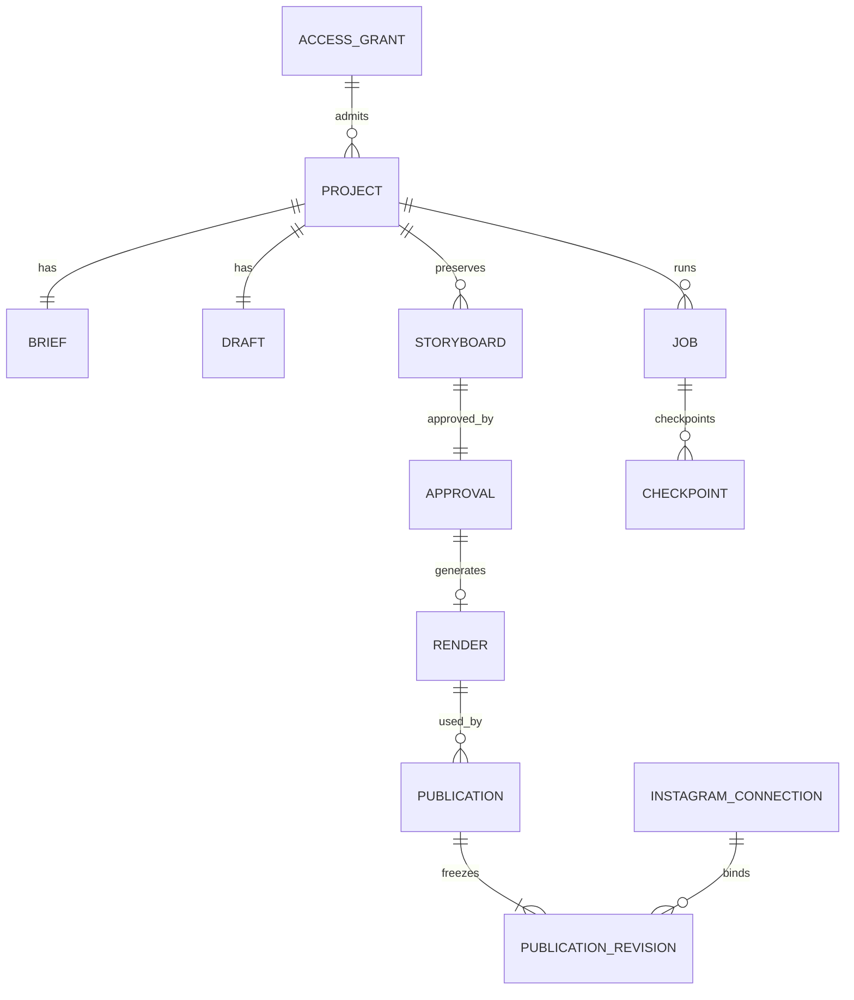

# ClipGleam V1 Database Design

**Version** 1.0 · **Status** Proposed implementation contract · **Date** 24 November 2026

Read with the [PRD](PRD.md), [system design](SYSTEM-DESIGN.md), [API design](API-DESIGN.md), [video quality standard](VIDEO-QUALITY.md) and [prototype pipeline](../PIPELINE.md). This design describes application persistence for the invited pilot. Local prototype files are development evidence. Import them only through an explicit, authorized fixture workflow.

## 1. Persistence model and invariants

Use MongoDB for state and private Cloudflare R2 for media, large immutable artifacts and restricted diagnostic data. Inngest coordinates execution and delayed dispatch. MongoDB remains authoritative for approvals, durable checkpoints, publish decisions and recovery. Use a transaction-capable MongoDB topology in dev and production, with indexes provisioned before traffic, primary reads for authoritative command checks, snapshot transaction reads and majority commit writes. Verify these settings on the selected pilot deployment. [MongoDB transactions](https://www.mongodb.com/docs/manual/core/transactions/)

### Conventions

- Documents have opaque string `_id`, integer `schemaVersion`, BSON `createdAt` and `updatedAt`. All creator records have `ownerId` equal to the opaque Better Auth user ID. Project children carry `projectId` unless specified otherwise. Cross-check all parents and references on writes and when workers load work. Date fields are BSON dates except the original local schedule text.
- Set IDs in the app before transaction retry. All human revisions and worker fencing counters are integer and monotonic. Stable storyboard scene, beat, layer and action IDs are scoped to the version and preserved across edits when content retains its identity.
- `ArtifactRef` stores exact `bucketAlias,objectKey,sha256,bytes,mediaType`. Store R2 locator keys server-side. Each published object has an immutable locator; replacement uses a new object. A signed URL is generated at access time. Keep BSON bounded with schema and byte limits even if request limits allow smaller bodies. Large provider responses, waveforms, QA frames, timelines and exports live in R2.
- A mutable storyboard draft can contain unresolved data. Accepted storyboard versions, approvals, verified render manifests, asset versions, stored narration units and publication payload revisions are immutable. State-bearing records that reference them evolve through guarded transitions. Never update a historical value to fit a newer default.
- An app actor cannot move documents between owners, and provider metadata cannot authorize a user. Ready media, active publish intent and published history have separate state. An old ready render survives a failed new render.
- Use Zod for authoritative boundary and semantic validation and MongoDB validators for critical types, required fields and enum sets. MongoDB does not enforce intercollection ownership, immutability or foreign keys. These are domain-service invariants with transactional guards and reconciliation.

## 2. Creator collections

In the collection tables, common fields from section 1 are implicit. Fields ending in Id reference opaque IDs. A null pointer means absence. `S` denotes stable fields and `M` mutable fields where both occur on a row.

| Collection | Fields and write rules |
| --- | --- |
| Better Auth collections | User, session, account and verification records are owned by the pinned adapter. Keep them outside app JSON contracts. Verify adapter indexes, provider-specific credential fields, expiration and hooks. App collections refer to user IDs only. [Better Auth MongoDB adapter](https://better-auth.com/docs/adapters/mongo) |
| `accessGrants` | Operator-managed admission. `emailKey` HMAC of normalized email, `userId?`, `state:invited\|enabled\|disabled\|expired`, `expiresAt?`, `stateChangedAt`, operator actor ID and reason. Unique email key and unique populated user ID. Admit only enabled verified user bindings. A separate TTL session/verification mechanism never serves as admission. |
| `projects` | `title,language,revision,state:active\|deleting,briefId,draftId,latestApprovalId?,latestReadyRenderId?,activeContentJobId?,messageSequence,nextStoryboardVersion,nextRenderVersion,deletedAt?,deletionId?`. Title CAS increments metadata revision. Internal counters and pointers update conditionally without invalidating unrelated metadata edits. Use latest successful render version, not most recent retry completion time, for the dashboard pointer. Projection flags for draft, scheduled, published and attention derive from authoritative records. |
| `briefs` | One per project. `revision,topic,audience,sourceText,learningObjective,targetSeconds?`. Bound user content by API limits. The project language applies to every plan. Workflows snapshot the exact inputs before invoking any provider. |
| `messages` | `sequence,role,text,kind,jobId?,candidateId?,clientCommandId?`. Append-only. Increment project message sequence and insert in one transaction. Scope Gemini context to a bounded window plus recorded high-water mark. Store user-visible content only here. |
| `drafts` | One per project. `revision,storyboard?,sourceStoryboardId?,sourceCandidateId?,editableHash,validation,validatedRegistryId?,validatedAt?`. `storyboard` uses the API schema. Store bounded validation issues with stable IDs. Recompute approval inputs against effective versions on approval. A past validation result is a UI hint. |
| `planRequests` | `briefRevision,draftRevision,promptTemplateVersion,effectivePrompt,promptHash,contextDigest,state:prepared\|accepted\|superseded,acceptedAt?,jobId?`. Prompt and provenance are frozen on creation. Restrict read access to that owner and relevant workflow service. |
| `candidates` | `jobId,briefRevision,baseDraftRevision,storyboard,diff,validation,providerProvenance,appliedDraftRevision?,appliedAt?`. Insert once per successful planning/revision job. Apply via CAS and preserve stale candidates for inspection. Provider provenance includes effective model, adapter/prompt versions and request ID if available. |
| `storyboards` | `version,parentStoryboardId?,sourceDraftRevision,sourceBriefRevision,storyboard,contentHash,manifestHash,registryId,rendererBuildId,fontBundleId,voiceConfig,assetVersionIds,approvedWarnings`. Snapshot contains complete render input intent and hashes. Freeze when approval is committed. Retain labels for creator audit and display. |
| `approvals` | `storyboardId,actorUserId,approvedAt,sourceDraftKey,contentHash,manifestHash,acknowledgedIssueCodes`. Actor comes from authenticated session. `approvedAt` is server time in UTC, regardless of browser clock. Store one approval per storyboard snapshot. |
| `deletions` | `resourceType,resourceId,state,phase,revokedAt,externalOutcomeSummary,lastError?,purgeAfter?,completedAt?`. This owner-readable record outlives the project briefly. Store counts and sanitized codes, omitting deleted project content. |

### Approval canonicalization

Use a versioned canonical serialization with ordered object keys, defined numeric representations, stable Unicode handling and existing array order. Serialize normalized server DTO values before hashing and use cross-platform golden vectors. Preserve approved narration, punctuation and ordering after validation. The editable hash covers the draft inputs visible in review. The manifest hash covers immutable storyboard inputs and resolved renderer, profile, registry, fonts, asset versions/checksums and voice configuration. Capture effective synthesis context rules, adapter and schema versions. Exclude labels that are operational metadata, such as processing timestamps and signed URLs. Render creation references the stored approval and manifest. Re-run current safety and availability checks without rewriting the manifest. If a pinned asset or runtime is unavailable, require repair or a new approval.

## 3. Asset, speech and render collections

| Collection | Fields and write rules |
| --- | --- |
| `uploads` | `expectedBytes,expectedMediaType,expectedSha256,originalFilename,quarantineKey,state:awaiting_upload\|queued\|inspecting\|ready\|rejected\|expired,uploadExpiresAt,inspectionJobId?,assetVersionId?,failureCode?`. Assign each upload attempt a unique quarantine key. Worker reads bounded bytes, verifies actual checksum and type, then normalizes with isolated tools to a separate immutable destination. A late or repeated PUT cannot change an approved asset. |
| `assets` | Logical assets with `visibility:catalog\|private,label,tags,kind,currentVersionId?,state:available\|withdrawn`. Private assets carry owner and origin project and are available only to that project in V1. Catalog versions are accessible via trusted catalog visibility and publication-use checks. Catalog written only by trusted operators. |
| `assetVersions` | `assetId,version,normalizedObject,dimensions,layerDescriptors,normalizerVersion,source,license,attribution,allowedUses`. Derive approved geometry/parts during normalization. Keep arbitrary SVG XML out of the renderer. Availability and emergency revocation belong to asset state or a separate policy record. Curated sources may allow export but prohibit publication; check use and show attribution when required. |
| `narrationArtifacts` | Owner-scoped cache with `fingerprint,provider,providerModel,voiceConfigVersion,deliveryVersion,alignmentSchemaVersion,audioRef,alignmentRef,measuredDurationMs,verifiedAt,sourceJobId`. May be shared by the same owner across projects through authorized references. Cache keys cover exact approved text, language, model/voice/settings including seed or provider context if used, adjacent text sent, format and normalization version. Before reuse verify checksum and matching timed transcript, plus availability. No cross-owner hits. |
| `renders` | `approvalId,storyboardId,version,manifestHash,originJobId,activeJobId?,state:pending\|ready\|failed\|cancelled,timelineRef?,outputRef?,verificationRef?,durationMs?,frameCount?,renderProfileId,readyAt?,failureCode?`. A retry uses the same render ID if the frozen approval is unchanged and the render is not ready. A ready result is immutable and retains links needed for exact playback and publication. |
| `artifactRoots` | Durable references limiting cleanup, `artifactType,artifactId,holderType,holderId,releaseAfter?`. Roots represent created/approved snapshots, job checkpoints, retained renders and unresolved publish intents. Expiry alone never releases a safety-critical reference. Repair using authoritative records. |
| `artifactInventory` | `objectRef,purpose,createdByJobId?,fence?,state:temporary\|committed\|deleting\|deleted,eligibleAfter?,lastCheckAt`. Use owned permanent keys and attempt-scoped staging keys. Register object intent before upload, verify bytes/checksum after transfer and commit reference with corresponding business state. Verify staged upload integrity again before promotion. |

### Compiled timeline and checks

Persist a versioned manifest for each render, containing profile, fps, dimensions, total frame count, scene/beat ranges, approved text digest, fingerprints and exact verified asset/audio refs, motion registry keys, cue frames, caption ranges, sound timing and pinned renderer/font config. Frame intervals are half-open `[start,end)`. Round boundaries from measured time with a single shared policy. Enforce ordering, positive lengths, total bounds, singular or explicitly disambiguated cue resolution, closed references and audio/caption fit. Cue compilation records alignment diagnostics. Verification stores codecs, fps, duration, frame count, stream decode results, caption placement checks and representative frames. A value beyond the duration review threshold is actionable. Store results by attempt. Promote the render and latest-ready pointer together only after QA and fence checks. Known prototype exceptions, including manually authored scenes, are recorded outside the production success claims.

## 4. Jobs, delivery and spending

| Collection | Fields and write rules |
| --- | --- |
| `jobs` | `kind:brainstorm\|plan\|revision\|voice_sample\|inspect_upload\|render,state,stage,frozenInput,inputHash,resourceRef,attempt,leaseUntil?,fence,workerId?,nextAttemptAt?,cancelRequestedAt?,predecessorJobId?,terminalAt?,error?,result?`. State enums match API. Stages depend on kind. Keep stable operation identity and distinguish business retries from workflow attempts. |
| `jobCheckpoints` | `jobId,stageKey,inputHash,attempt,fence,artifactIds,outcome,completedAt`. Checkpoint keys include stable beat IDs where applicable. Reuse verified outputs with a matching input hash. A stale worker cannot write an accepted checkpoint or promote a result. |
| `providerCalls` | `jobId?,publicationId?,operationKey,provider,phase,reservationId?,state:reserved\|started\|confirmed\|definite_failure\|uncertain,requestDigest,providerRequestId?,sanitizedCode?,startedAt?,settledAt?`. Journal each chargeable or externally visible action before crossing the boundary. Exact provider capability controls retry. |
| `quotaWindows` | Environment/provider/UTC window keys with configured ceiling and `reserved,consumed`. Reserve in a transaction before dispatch, settle on confirmed usage or release on definite no-use. Conservatively hold uncertain charges until reconciliation or operator resolution. Optional per-owner budget and global concurrency cap. No customer billing data. |
| `outbox` | `eventId,eventName,aggregateType,aggregateId,aggregateRevision?,availableAt,state:pending\|sending\|sent\|dead,attempt,leaseUntil?,fence,deliveredAt?,lastError?`. Stable event ID per business occurrence. Payload has IDs only. Mark sent after transport acknowledgement. Bounded retries with alarms and repair scan. |
| `commandReceipts` | `ownerId,method,routeKey,keyDigest,requestHash,httpStatus,resultRef,safeResponse,createdAt`. Persist atomically with accepted writes. Scope by concrete matched path. No passwords, disposable media URLs or secrets in receipt data. OAuth receipts persist session reference and reconstitute a still-valid authorize redirect from sealed, short-lived state. |

Transitions for generation use queued → running → succeeded, failed or cancelled, with waiting_retry returning to running when due. Stages for render are preparing, narrating, compiling, rendering and verifying. Planning/revision stage vocabulary is preparing, planning or revising, and validating. Upload and voice sampling use their own named stages. Record stage changes, failure code and next eligible attempt. A terminal state is immutable. Retry links a successor job and attaches verified prior checkpoints or artifact references, with a new fence and workflow event. Browser closure never edits job state.

A lease makes work recoverable, while a monotonic fence prevents a late worker from settling the current attempt. Every side-effecting write includes job ID, fence, expected state and an authorization check. Heartbeat and renew while executing. Lease expiry grants another worker the right to resume only after checking provider journals and artifact validity. Workers outside MongoDB stage artifacts first and best-effort clean up; only a committed reference grants usability. A provider success can arrive after cancellation or a lost connection. Retain restricted evidence for diagnosis and reconcile usage, with no cancelled job promotion. Do not retry a potentially accepted Instagram publish using the generic job retry path.

## 5. Instagram collections and scheduler

| Collection | Fields and write rules |
| --- | --- |
| `instagramConnections` | Owner-scoped. `provider,providerAccountId,handle,status,isActive,authFence,credentialRevision,grantedScopes,tokenCiphertext?,keyId?,expiresAt?,verifiedAt,disconnectedAt?`. Envelope-encrypt tokens with environment-specific keys and owner/connection context. Restrict decryption to OAuth and publish services. Keep one active connection per user. Refresh increments credentialRevision. Reconnection with different account creates a new record and disables previous connection. |
| `oauthStates` | `ownerId,sessionBinding,stateDigest,sealedState?,expiresAt,consumedAt?,returnTarget`. Fixed return targets, atomic consume, compare session and expiry before exchange. Keep short-lived encrypted material only where needed to replay authorize URL. Exchanging a code claims state once, outside MongoDB. If the app fails before storing credentials, restart OAuth. Finalization rechecks admission, connection revision and state claim and fences concurrent replacements. |
| `publications` | `provider,connectionId,renderId,revision,activePayloadId,requestFingerprint,duplicateGuard,state,nextActionAt?,leaseUntil?,fence,cancelledAt?,claimedAt?,publishedAt?,providerPostId?,permalink?,terminalReason?`. A publication owns its state across payload versions. requestFingerprint binds provider destination ID, output hash and exact caption independently of schedule time. payloadHash also binds mode and time. Rescheduling retains the business guard. Preserve previous schedule revisions. Active/confirmed/uncertain duplicates hold the business guard. A definitive failure or cancel can release it transactionally. |
| `publicationRevisions` | `publicationId,revision,actorUserId,approvedAt,renderId,renderSha256,connectionId,providerAccountId,caption,mode,localDateTime?,timeZone?,utcOffset?,scheduledAt?,payloadHash`. A reschedule inserts a new immutable revision and changes the parent pointer. Confirm schedule against configured late window and originating zone before latest pointer update. Preserve planned UTC instant even if timezone definitions later change. |
| `publicationAttempts` | `publicationId,payloadRevision,attemptNo,fence,phase,remoteContainerId?,remotePostId?,lastRemoteStatus?,transmissionStartedAt?,nextCheckAt?,reconcileDeadline?,evidenceRef?,failureCode?`. Record container creation and publish submission independently. A remote post ID discovered via reconciliation still requires confirmation. Never mark no-post from absence in a list alone. |
| `deliveryGrants` | `publicationId,payloadRevision,renderId,renderSha256,grantDigest,expiresAt,revokedAt?,lastAccessAt?`. Server stores only the token digest and supplies a limited URL once. Check exact payload and grant policy at every GET/HEAD. Revocation blocks future requests; a response already streamed may finish. Allow sufficient fetch lifetime and retries for Meta processing. |

Eligible transition graph:

- `scheduled → queued → dispatching → processing → published` where provider processing may also occur around container creation. Dispatch moves to `reconciling` after uncertain submission, and `published`, `failed` or `needs_attention` follow evidence. A dead reconciliation remains blocked for resend pending definitive outcome.
- Before claim, `scheduled/queued → paused, cancelled, missed` as applicable. Reschedule eligible paused or missed scheduled payloads with a fresh revision. Resume a paused Post now against the same confirmed destination, after a safe-phase and authorization check. A potentially submitted attempt remains in reconciliation. A definitive failed Post now can be retried against the same payload after current destination and quota checks, reacquiring its duplicate guard. A success never goes back to dispatch.
- Schedule sweeper reads `nextActionAt` for due or stalled work and conditionally re-emits the current revision. A stale event cannot claim a rescheduled intent. On dispatch, compare revision/fence, active owner/project, credential identity, exact verified MP4 and lateness. Immediately before provider submission, transactionally record the external-action start and recheck gates. The external API and MongoDB cannot commit together. Keep reconciliations active even after access is revoked, with minimum provider evidence and no new publication.
- Concurrent cancel and dispatch are serialized by guarded claim writes. Project deletion and connection disable participate in the same authoritative project/connection documents and worker gates. If the claim wins and an external call may have begun, preserve unresolved attempt and report that explicitly. Use phase checkpoints to stop safely before a provider call if it has yet to start.

## 6. Index plan

Fields default to ascending, minus denotes descending. Include MongoDB's unique `_id` index on every collection. Verify query plans with representative owner sizes. Use named indexes and simple partial filters tested against the deployed engine. Leave partial unique fields absent where practical, and do not rely on null uniqueness.

| Collection | Indexes and purpose |
| --- | --- |
| `accessGrants` | Unique `emailKey`; unique `userId` partial on string values. |
| `projects` | `(ownerId,state,-updatedAt,-_id)` dashboard; `(state,deletedAt)` deletion scan. Monitor derived dashboard flags before adding projection indexes. Filter by state and flags before applying page limit. |
| `briefs,drafts` | Unique `(ownerId,projectId)` singleton lookup. |
| `messages` | Unique `(ownerId,projectId,sequence)`. |
| `storyboards,renders` | Unique `(ownerId,projectId,version)`; `(ownerId,projectId,-createdAt,-_id)`; renders also unique `(ownerId,approvalId)` for deduplicated render requests. |
| `approvals` | Unique `(ownerId,storyboardId)`; unique `(ownerId,projectId,sourceDraftKey)` with sourceDraftKey derived from draft revision and manifest hash. |
| `planRequests,candidates,uploads` | `(ownerId,projectId,-createdAt,-_id)`; candidates unique `jobId`; uploads `(state,uploadExpiresAt)`. |
| `assets,assetVersions` | `(ownerId,projectId,state)`, `(visibility,state,kind,label,_id)` on assets; unique `(assetId,version)` on versions. Catalog cursor binds active filters. |
| `narrationArtifacts` | Unique `(ownerId,fingerprint)`; `(ownerId,verifiedAt)` for cache reconciliation. |
| `artifactInventory,artifactRoots` | Inventory unique `(objectRef.bucketAlias,objectRef.objectKey)`, `(state,eligibleAfter)`; roots unique `(artifactType,artifactId,holderType,holderId)` and `(holderType,holderId)`. |
| `jobs,jobCheckpoints` | Jobs `(ownerId,projectId,-createdAt,-_id)`, `(state,nextAttemptAt)`, `(state,leaseUntil)`; unique checkpoint `(jobId,stageKey,inputHash)`. Project active job pointer is the reservation guard. |
| `providerCalls,quotaWindows` | Calls unique `(provider,operationKey)`, `(state,startedAt)`; quota unique `(environment,provider,windowStart,scopeKey)`. |
| `outbox,commandReceipts` | Outbox unique `eventId`, `(state,availableAt,_id)`, `(state,leaseUntil)`; unique receipts `(ownerId,method,routeKey,keyDigest)`. |
| `instagramConnections,oauthStates` | Connections unique `ownerId` partial on `isActive:true`, `(ownerId,providerAccountId)`; OAuth unique `stateDigest`, single-field TTL `expiresAt`. |
| `publications` | `(ownerId,projectId,-createdAt,-_id)`, `(state,nextActionAt,_id)`, `(connectionId,state)`, `(state,leaseUntil)`, unique `(ownerId,requestFingerprint)` partial on `duplicateGuard:true`; unique `(provider,providerPostId)` partial on string post ID. Set provider from the accepted connection. |
| `publicationRevisions,publicationAttempts` | Revisions unique `(publicationId,revision)`; attempts unique `(publicationId,payloadRevision,attemptNo)`, lookup on `remoteContainerId` and `(phase,nextCheckAt)`. |
| `deliveryGrants,deletions` | Grants unique `grantDigest`, `(publicationId,payloadRevision)`, TTL on `expiresAt` once grant evidence policy allows; deletions `(ownerId,resourceId)`, `(state,purgeAfter)`. |

MongoDB TTL cleanup is asynchronous. Treat expiry as an explicit authorization check. TTL is suitable for disposable OAuth and grant data. Use explicit lifecycle jobs for objects, tombstones, idempotency evidence and referenced artifacts. [MongoDB partial indexes](https://www.mongodb.com/docs/manual/core/index-partial/) · [MongoDB TTL indexes](https://www.mongodb.com/docs/manual/core/index-ttl/)

## 7. Atomic writes and recovery

| Operation | Single transaction | Recovery and external boundary |
| --- | --- | --- |
| Create project | Admission check, project, brief, draft and receipt. | Replay same resource after lost response. |
| Save or apply draft | CAS target revisions, resolve ownership, update draft, candidate applied pointer where applicable, update dashboard time. | Stale candidate stays inspectable. Treat brief consistency as a commit guard on apply. |
| Approve snapshot | Guard exact draft revision/hash, readiness and effective manifest, allocate version, write storyboard, approval, referenced roots and receipt. | Duplicate approval for same draft/manifest returns original. New effective dependency requires preview and approval. |
| Accept async command | Verify owner and project state, reserve active content slot where applicable, persist frozen data, job/result stub, outbox and receipt. | Dispatch retry after failed send. Inngest redelivery reloads state and claims conditionally. |
| Finish stage or render | Verify lease/fence and input hash, persist checkpoint/object reference, update stage or terminal state, release content slot if still held by that job. For ready render set pointer only if newer than prior Ready. | Orphan inventory scan clears unreferenced staging objects after a grace period. |
| Schedule, move or cancel | Validate active destination and verified output, write or fence immutable revision, update states/guard/roots, insert receipt and dispatch event when relevant. | Old alarms recheck active revision. For a cancel before claim revoke delivery grant in same operation where present. |
| Claim or start provider action | Guard active version, parent/connection and admission, fence processing attempt, journal call and optional quota reservation. | No external calls inside database transaction. Resolve lost response using persisted IDs and conservative uncertainty policy. |
| Delete project | Authorized tombstone, deletion record, receipt and outbox. Block child access by parent check immediately. | Cleanup worker sweeps child jobs/schedules/grants, releases roots after reconciliation and purges in batches. Gateway checks parent before every new read. |

Use an internal authFence integer on accessGrants, projects and instagramConnections for side-effect barriers. It increments independently of any creator-visible revision. Use transactional conflict gates on shared records where an invariant spans multiple documents. For example, claim or approve after reading project/admission must also write a guard revision on the relevant authorization document using expected value, or perform an equivalent tested serializing write. Checking snapshot reads alone permits write skew. Establish deterministic write order for hot operations and bound transaction retry. Resolve unknown commit results through driver commit retry and receipt lookup. App resumes with stable command IDs. Workers and dispatcher recover claimed-but-inactive work from durable state. [Inngest idempotency](https://www.inngest.com/docs/durable-execution/guides-and-advanced/idempotency)

## 8. Storage, retention and private data

| Data | Proposed policy for pilot review |
| --- | --- |
| Active project data and ready exports | Retain until deletion or operator-approved pilot wind-down. Preserve superseded render versions while referenced by an active publication or explicitly retained for review. |
| Draft and candidate history | Keep immutable approved snapshots. Retain unapplied candidates for 30 days, subject to creator/project deletion and active references. Keep latest editable draft and conversation for the life of the project. |
| Quarantine and temporary objects | Upload grant up to 15 minutes, uncompleted/quarantined bytes purged after 24 hours when safe. Stage output grace 24 hours after terminal outcome or abandoned lease, provided no canonical reference. |
| Narration cache | Candidate 30-day last-use eviction for unreferenced narration. Set last-use in inventory metadata or a separate access counter. Keep artifacts used by current work or retained manifests. |
| Logs and raw provider payloads | Structured operational logs for 30 days as a starting point. Omit private prompts, tokens, grants and raw audio. Diagnostic payloads disabled by default; limit access, document purpose and set a short purge deadline if enabled. |
| Creator deletion | Immediately revoke reads and new work. Target primary-store purge within 7 days once external outcomes are resolved; report blocked cleanup. Tombstone response and minimized command evidence can survive for up to 30 days following completion. Keep unsettled publication evidence until resolution and review. Historical posts on Instagram stay live. |
| Backups | Use encrypted scoped backups if supported by host, validate restore and document actual backup retention before onboarding. Replay deletion ledger and reconcile external publication before enabling workflows on restore. |

R2 buckets stay private. Creator previews and downloads use session-checked delivery. Any directly signed upload URL is a bearer grant valid until expiration. The quarantine key and promotion checks prevent use after cancellation; orphan cleanup handles late writes. Separate environment credentials and keys for media, worker, auth and publication. Support re-encryption by key ID. Revoke active grants and credentials on disconnect or deletion as applicable. Keep referencing records until R2 cleanup confirms object deletion. Scrub secrets from ordinary logs, errors, telemetry and request traces. On provider reconciliation, retain only data needed for that operation. [Cloudflare R2 presigned URLs](https://developers.cloudflare.com/r2/api/s3/presigned-urls/)

## 9. Migrations, observability and acceptance

- Apply ordered idempotent migrations with a migration ledger and single migration runner. Verify index creation and MongoDB validator compatibility before deploy. Use expand, dual-read or adapter compatibility, idempotent backfill, verify and contract. Keep old timeline and storyboard readers needed by approved renders or mark the version unavailable pending fresh approval. Existing publication payloads retain their exact references.
- Separate local, test and pilot databases, buckets and signing keys. Use seeded test accounts and synthetic content. Rehearse recovery from database restore with outbox sends, scheduler and external sends disabled. Reconcile known post IDs, unknown attempts, expired credentials and deleted owners before reenabling.
- Monitor stuck leases, stale active slots, due publication lag, duplicate command/intent collision, orphan objects, MongoDB contention, quota/usage reservations, blocked deletions and reconciliation age. Every record transition should be traceable through request, job, attempt and provider correlation IDs. Redact private payloads.
- Verify parallel project creation and repeated commands, stale draft and PlanRequest, approval versus concurrent edit, write skew during disable/dispatch, unknown transaction commit, outbox replay after dedupe window, stale worker promotion and restarts after R2 upload before commit.
- Verify asset revocation, mixed-owner references, ABA changes to identical draft content, wrong checksum or storage substitution, same-owner audio reuse and cross-owner isolation, missing renderer build, stale render completion and regression to old video pointer.
- Exercise UTC/zone round trips, ambiguity and nonexistent local times, concurrent cancel/reschedule/claim, duplicate providers, external publish succeeded before response loss, uncertain attempt with no provider ID, project deletion with active fetch and delayed TTL cleanup. Require evidence of a confirmed single external post before enabling normal retry policy.
- Open deployment gates are actual MongoDB features and backup terms, provider model and voice configuration, schedule reliability, Meta review and scope eligibility, renderer hosting/licensing, retention and pilot policy thresholds. These proposed values need sign-off before implementation release.

## References

- [NamasteVideo.ai database design](https://github.com/akshaymarch7/namaste-video-ai/blob/main/DB_DESIGN.md) informed the separation of editor state, immutable versions, work records, indexes and publication history.
- [MongoDB transaction behavior](https://www.mongodb.com/docs/manual/core/transactions/), [Better Auth MongoDB adapter](https://better-auth.com/docs/adapters/mongo) and [Inngest retries](https://www.inngest.com/docs/durable-execution/guides-and-advanced/error-handling/retries).

## Implemented private project slice

The project library uses the owner, state and recency compound index. Create writes the project, empty brief and draft in a single transaction. The owner-scoped request key derives the project ID and the project records the original creation fields to support replay. Deletion clears the title and creation title, removes the initial brief and draft in one transaction, and retains a minimal project tombstone for repeat-delete handling. Retention and asynchronous cleanup are released with future media and publication features. Use a MongoDB replica set or sharded cluster for project mutations.
