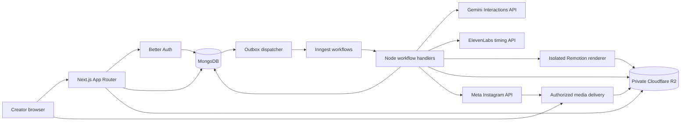

# Clipgleam V1 System Design

**Version** 1.0 · **Status** Proposed implementation design · **Date** 24 November 2026  
**Audience** Engineers building the private pilot.  
**Product baseline** [V1 PRD](PRD.md) and [video quality standard](VIDEO-QUALITY.md).

## 1. Scope and evidence

Build a private application for planning, approving, rendering and publishing short educational and product explainers. The creator flow is Plan → Storyboard → Generate and preview → Export or publish. V1 has one language and narrator per video, English validated first, vertical MP4 exports and one eligible Instagram destination per user. Initial accounts are invitation-only. Keep customer billing, shared workspaces, batch creation, additional destination integrations and multilingual versions outside the implementation scope.

| Proven locally | Requires application implementation and validation |
| --- | --- |
| Gemini-generated plans, ElevenLabs speech alignment, reusable React/SVG motions, locally bundled DM Sans and verified Remotion exports | Authenticated dashboard, persisted projects, general-purpose storyboard adapter, hosted jobs, cloud rendering, R2 and Instagram |
| The creator-approved 87.8-second seasons cut, developed with reviewed scripts and topic-specific visuals | An independently created new topic meeting the same quality bar with reusable motions and resolved assets |
| Gemini Interactions API produced 16 validated visual directions, and a cache-only rerender preserved decoded audio exactly | Production Interactions adapter for planning and revision, reusable Zod schemas and provider reliability verification |

The [prototype design](../PIPELINE.md) records reproduction commands. Pilot deployment should minimize spend. Free access, licensing, hosting availability and always-on scheduling are separate checks.

## 2. Topology and responsibility boundaries

Start with one TypeScript repository, one Next.js App Router application running on Node.js, and separate execution capacity for the renderer. Organize application code by domain so the UI, workflow handlers, and render process can share contracts while having different permissions.

| Boundary | Owns |
| --- | --- |
| Web app | Invite and session flow, project and storyboard editing, previews, status projection and user commands. Return promptly after accepting long work. |
| Domain services | Owner checks, Zod validation, revision conflicts, approvals, job reservations and publication intents. Invoked by both UI mutations and background handlers. |
| MongoDB | Durable product state, version references, job progress, delivery metadata and outbox entries. |
| Inngest | Workflow execution, delays, bounded retries and concurrency. Project, checkpoint and schedule state remain recoverable from MongoDB. |
| Render worker | Trusted local code and fonts, frame rendering, encoding and output inspection. Consumes a pinned media manifest with narrowly scoped access. |
| Private R2 | Media and larger artifacts. Object keys and uploaded content are not authorization. |
| Provider adapters | Translate internal contracts into Gemini, ElevenLabs, render-host and Meta requests. Keep provider responses and failures behind these boundaries. |

Select the web and render hosts after a benchmark. A local or dedicated Node renderer is the initial known execution path. A sandbox or container host is a deployment candidate depending on cost, Chrome and FFmpeg availability, time limits, storage, cold starts, cleanup and concurrency. Use one workflow engine. Avoid a second custom queue until there is evidence it is needed.

## 3. Application and creator state

| Surface | Server-owned state | Browser behavior |
| --- | --- | --- |
| Dashboard | Owner-scoped project summaries, recent renders, job status | Create, resume, rename and delete. Refresh status from server state. |
| Plan | Brief, language, target duration, reference notes and conversation | Edit brief, brainstorm or request a storyboard. Preserve prior drafts. |
| Storyboard | Versioned scene plan, resolved assets, cue references, validation state and approval | Autosave, reorder, edit text or request scoped revisions. Preview each action and surface unresolved visuals. |
| Generate and preview | Job and step checkpoints, compiled timeline, output validation, ready render pointer | Show stage progress, resume after reload and preview the exact finished asset. |
| Export or publish | Approved render, active connection, caption, publishing intent and schedule | Download without Instagram. Confirm destination, time, timezone and visible results. |

Browser state is temporary. Use revision comparisons on edits and flush pending changes before an approval or generation action. Show save failures and stale revisions. Keep private client caches scoped to identity and clear them on sign-out. Use polling for the initial job-status implementation. Live push is optional if the pilot shows polling creates poor responsiveness or excess load.

## 4. Identity, permissions and trust

Better Auth establishes the user session. An internal invite or allowlist enables onboarding. Recheck eligibility when granting access. Derive owner identity from the authenticated session, then scope lookups and mutations by owner and resource. Swapping IDs, opening a media URL or calling a job endpoint directly must not grant cross-account access.

Jobs use trusted service authentication and explicit operation context. A worker loads the pinned job and revalidates its owner and authorization before accessing media or attempting external publication. Render workers have no need for Gemini, ElevenLabs or Instagram credentials. Issue access only for the inputs and output of that job. Handle cookies, mutation protection, signed workflow events, OAuth state and callbacks at the relevant trust boundaries.

Keep provider credentials server-side, separate by environment. Encrypt Instagram tokens and restrict access to the publishing service. Never include credentials, full private prompts, signed URLs or raw provider payloads in ordinary logs. Treat pasted references and model content as data. Persist the minimum data required to support review and recovery.

## 5. Artifacts, versions and approval

| Artifact | Purpose |
| --- | --- |
| Brief and conversation | Creator context, references and revision requests. Conversation ordering is controlled per project. |
| Storyboard version | Editable script and visual intent captured as an immutable version when approved. Includes ordered shots, stable identifiers, asset requests, timing estimate and cue anchors. |
| Asset version | Normalized and inspected file, provenance, license or use requirements, layer anchors and an immutable content reference. |
| Narration artifact | Approved spoken text fingerprint, provider, model, voice, settings, audio, alignment, measured duration and diagnostics. |
| Compiled timeline | Frame ranges, audio references, caption windows, assets, motion parameters, cue frames and renderer/font versions. |
| Render result | Private media reference, originating approval and timeline, file fingerprint, measured duration and validation report. |
| Publishing intent | Approved render, destination account, social caption and schedule instant if applicable. Later edits form a new intent version. |

Use a canonical content fingerprint for approved inputs and reuse checks. Record approval by authenticated actor, time and exact version. A later revision never mutates the approved snapshot or an in-flight job. A new valid render may become the latest project preview, while old renders remain addressable by existing approvals and active schedules. Serving a different render requires a new publishing intent.

The [database design](DATABASE-DESIGN.md) defines collections, indexes, transactions, retention and migrations. The [API design](API-DESIGN.md) defines versioned routes, authorization, idempotency, mutation preconditions and error handling.

## 6. Planning, visual assets and media generation

### Planning and adjustment

Use Gemini Interactions for idea planning, structured storyboards and conversational revision. Clipgleam owns conversation history and can reconstruct calls from approved context. Start with stateless requests where supported, then evaluate provider-side conversation state only if it has a clear benefit. Record the exact model, prompt revision and response provenance per run. Configure verified models and fallbacks server-side. Keep one operation active per project for planning, revision or generation, while allowing the creator to work on a draft.

Validate Gemini responses and internal transitions with versioned Zod schemas. Perform separate semantic validation for IDs, referenced assets, supported actions, cue occurrences, scene lengths and factual-review flags. Reject model-supplied code and arbitrary URLs. A valid response remains a draft. During the pilot, record approval of the exact planning prompt before submission. Require approval of the generated storyboard before full speech or encoding.

### Visual resolution and preview

Use a registry of reusable motion primitives such as reveal, highlight, move along a path, pan, compare and sequence. Compose scenes from those primitives, validated SVG shapes, curated illustrations and creator assets. Use specialized components only where they capture real behavior, such as an orbit, search algorithm or an AC phase diagram. Gemini specifies what to show, what changes and which phrase triggers it. Engineers maintain the trusted React, SVG and CSS renderer.

Resolve named asset requests against original vectors, approved catalog imports and authorized user uploads. Track provenance and attribution. Sanitize and normalize SVGs through an allowlisted parser or a vetted conversion path before including them in the renderer. For example, a cricket shot needs independent bat, ball, stumps and bail layers if those objects move separately. For an unsupported required visual, return the gap to the storyboard editor. On-demand illustration generation is a candidate after quality, cost and usage terms are evaluated.

Render light previews using the same components, DM Sans and visual configuration as the final composition. If narration is still estimated, label the preview accordingly. Show key frames before and after meaningful cues. A visual edit can reuse matching narration, but a new voice, spoken line or delivery setting invalidates affected audio. If neighboring text affects delivery, invalidate neighboring speech requests whose context changed.

### Speech, timing and render

1. Pin approved storyboard, voice, language, visual asset versions and effective render configuration.
2. Call ElevenLabs for timestamped narration. Compare returned alignment to the approved lines with explicit normalization rules. Verify decodability and measured duration. Cache per owner and complete synthesis input.
3. Compile timings to video frames. Check caption bounds, audio fit, unique phrase anchoring and supported visual actions. Surface duration deviations that need creator review. Keep the expected output around 60–90 seconds without a global slowdown as a default.
4. Render in Remotion with React, SVG, CSS and local fonts. Build a browser composition from the compiled timeline. Encode H.264/AAC with FFmpeg. Inspect dimensions, frame rate, streams, duration and integrity using FFprobe and decode checks. Initial profile is 1080 × 1920 at 30 fps.
5. Promote only the validated output to Ready and keep a stage manifest for diagnosis and retry. Human review of representative frames, factual accuracy, voice and accessibility remains part of the quality gate for pilot samples.

## 7. Workflow delivery, recovery and cancellation

Accept long work by recording the job, its frozen inputs, an operation identifier and an outbox record in one transaction. Confirm the deployed MongoDB configuration supports the chosen transaction pattern. A dispatcher drains the outbox into Inngest with a stable event ID. Periodic reconciliation repairs missing dispatches. Inngest and providers can repeat deliveries, so application checkpoints must tolerate at-least-once execution.

Track durable stages: Queued → Preparing → Narrating → Compiling → Rendering → Verifying → Ready. Terminal failures and cancellation carry a specific reason. UI labels map from these states and omit invented percentages. Recover completed steps by inspecting the checkpoint and artifact fingerprint. Protect execution with a claim or lease and fencing identifier so stale workers cannot promote outputs after a retry or cancellation. Upload temporary artifacts to attempt-scoped locations, then promote references with a conditional state update. Reconcile orphaned temporary artifacts.

Retry timeouts, transient 5xx and recoverable rate limits with bounded backoff and jitter. Treat invalid data, missing scopes and hard quota exhaustion as actionable failures. Log the affected stage, provider status and elapsed time. If a paid provider call has an uncertain outcome, reuse it only with a confirmed matching artifact or provider result. Budget any retry that could incur another charge. Failed new work preserves the last ready export.

Cancellation prevents new stages and external effects where possible. An already-running provider request or encoding process may finish. A cancelled or superseded job must not promote an artifact. Browser closure never cancels accepted work.

## 8. Private assets, delivery and retention

Record ownership and allowed uses alongside storage references. Transfer clips, alignments and videos through private R2 rather than storing large binaries in MongoDB. Authorized creator previews and downloads use short-lived access. Keep storage credentials out of the browser. Treat active signed URLs as bearer grants and choose a lifetime consistent with playback or download.

Meta delivery needs a URL reachable by Meta for its processing window. Use a limited grant or narrow media endpoint bound to the approved payload, distinct from ordinary creator preview. Validate the exact delivery mechanism during the Meta integration. Match range and content-type behavior to the transport. Expose one object for one purpose and avoid credentials in payload paths or logs.

On deletion, revoke creator access and pending delivery grants, stop unclaimed jobs and schedules, and audit unresolved external actions. Purge media after retention rules and references permit, including superseded attempts. A local deletion does not remove a post already published to Instagram. Set retention duration, restore policy and private payload lifecycle before the pilot.

## 9. Instagram and schedule lifecycle

Connect an eligible professional account using Meta’s official flow. Bind OAuth state to the initiating user and session and handle cancellation, mismatched or expired state, denied scope and expired credentials. Confirm destination identity before enabling publishing. Reconnection to a different account leaves previous intents bound to their original destination until the creator explicitly replaces them.

| Step | Behavior |
| --- | --- |
| Approve | Freeze render fingerprint, account identifier and caption. Save UTC instant and originating timezone for schedules. |
| Dispatch | For Post now, start immediately. For schedules, Inngest coordinates due work and a periodic due-job scan repairs missed dispatches. Claim only an active intent. |
| Recheck | Verify approval, ownership, account, media availability and valid credentials. Resolve timezone ambiguity at selection time. |
| Submit | Give Meta scoped media access, track the remote container and processing state, then request publication once. |
| Reconcile | Persist remote identifiers as soon as known. An ambiguous timeout enters Needs attention or Reconciling until resolved. |
| Confirm | Mark Published only after provider confirmation and show a link when available. Repeated clicks or workflow replay must not create duplicate publication. |

Allow cancel or reschedule before claim. During dispatch, reconcile the real external outcome instead of claiming cancellation succeeded. Define a lateness window during system implementation. After that window, surface the missed post for review rather than silently publishing late. Verify Meta access, media limits, upload processing, credentials, delivery URL lifetime and test-account requirements before enabling the integration. Dependable scheduling needs an always-available workflow handler.

## 10. Operations, environments and quality gates

Use local development, an isolated integration environment and an invite-only pilot. Keep databases, buckets, callback origins, signing keys and provider credentials isolated. Pin Node, Chromium, fonts and Remotion versions across previews and exports. Benchmark multiple topics and concurrent work on the candidate renderer. Measure CPU, memory, disk and duration before choosing timeouts or concurrency. Run one active generation per project, set a small global render pool and cap provider usage to prevent runaway pilot spend.

Emit structured logs with project, job and attempt identifiers, stage durations, model, sanitized outcome, retries, cache use and correlation identifiers. Measure queue wait, completion rates, time to usable preview, provider errors, rendering time and publication delay. Alert when jobs stall, dispatches accumulate, auth expires or outcomes remain unknown. Confirm alerts are actionable and appropriate for a small pilot. Expose creator-friendly errors rather than provider internals.

Test at four levels:

1. **Unit and contract** — Zod failures, cue matching, normalized text, frame bounds, asset references and scheduling timezone.
2. **Integration** — Invite flow, two-owner isolation, private media, idempotent command replay, outbox recovery, worker restarts and cancellation races.
3. **Media** — Visual-only revision reuses speech, text or voice change invalidates the required cache, no incomplete MP4 promoted, and playable 9:16 export with synchronized captions and readable graphics.
4. **Pilot and publishing** — Two independent Instagram test accounts, schedule replacement, revoked token, ambiguous response reconciliation and creator-led completion on a genuinely novel topic. Compare results against the [approved quality benchmark](VIDEO-QUALITY.md).

## 11. Delivery sequence and remaining decisions

| Milestone | Exit condition |
| --- | --- |
| System design review | Agree on boundaries, scope and the release gates in this document. |
| API and database design | Specify versioned contracts, permissions, schema, indexes, state transitions, transaction and retention rules. |
| Web workspace | Invited users can open isolated dashboards, save briefs and review immutable storyboard versions. |
| Durable generation | Live Gemini Interactions, ElevenLabs and Remotion produce a verified downloadable video. Recovery and replay checks pass. |
| Asset and quality gate | A creator can complete a new-topic explainer with sufficient visual fidelity. Unsupported shots are flagged before synthesis. |
| Instagram pilot | Eligible testers can publish and schedule the exact approved asset, and duplicate or uncertain outcomes are reconciled. |

Open implementation choices include host and quota limits, provider model and voice presets, invitation delivery, measurable performance goals, retention, Meta prerequisites, and the first asset categories. These do not block API and database design. Treat hosted rendering, automation coverage and commercial use as proven only after their corresponding tests and eligibility checks.

### Traceability

| PRD requirements | Design coverage |
| --- | --- |
| FR-01, FR-13, FR-14 | Creator state, identity, version conflicts, cancellation and retention |
| FR-02–FR-07 | Planning, approved storyboards, asset sourcing, audio alignment, pacing and visual quality |
| FR-08, FR-09 | Outbox delivery, durable workflow checkpoints, render validation and export |
| FR-10–FR-12 | Instagram authorization, frozen intents, schedule dispatch and reconciliation |

### References

- [NamasteVideo.ai system design](https://github.com/akshaymarch7/namaste-video-ai/blob/main/SYSTEM_DESIGN.md), reference for modular boundaries, immutable media versions, durable jobs, private delivery and publication reconciliation.
- [Clipgleam V1 PRD](PRD.md), [progress log](PROGRESS.md), [quality standard](VIDEO-QUALITY.md) and [pipeline technical design](../PIPELINE.md).

### Storyboard editing boundary

The creator can customize the script, shot order, shot timing intent, assets, layers, labels, camera and supported animations, speech cue anchors, captions and voice before committing to generation. Represent each edit as validated storyboard data. Resolve previews against the same versioned assets and renderer registry as export. Warn when editing narration breaks a cue or when replacing an asset removes an independently animated layer. Diff each AI revision against the current draft, preserving unrelated work and requiring a new approval when the render inputs change.
